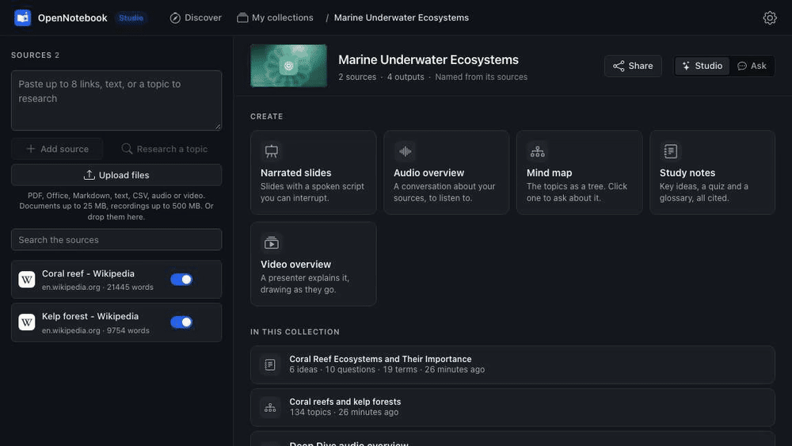

<div align="center">

# Notabit

**The open-source, self-hosted NotebookLM alternative.**<br>
Turn PDFs, web pages, YouTube videos and recordings into narrated slide decks, video and audio overviews, mind maps and study notes. Every claim links back to its source.

[](https://github.com/mahmoud-emad/notabit/actions/workflows/ci.yml)
[](https://github.com/mahmoud-emad/notabit/releases)
[](LICENSE)
[](#try-it)
[](https://github.com/sponsors/mahmoud-emad)
[](CONTRIBUTING.md)
[](https://alternativeto.net/software/notabit/)
[](https://glama.ai/mcp/servers/mahmoud-emad/notabit)
[](https://hub.xerj.org/contributors/mahmoud-emad)

[Website](https://mahmoud-emad.github.io/notabit/) · [Try it](#try-it) · [What it makes](#what-it-makes) · [Why it exists](#why-notabit) · [Roadmap](#roadmap) · [Contributing](CONTRIBUTING.md) · [Discussions](https://github.com/mahmoud-emad/notabit/discussions)

<a href="https://mahmoud-emad.github.io/notabit/"></a>

<sub>A collection, a narrated deck, and a cited answer. The <a href="https://mahmoud-emad.github.io/notabit/">full-quality video</a> is on the website.</sub>

</div>

## What it makes

Put your sources into a collection: PDFs, Office files, web links, YouTube videos, audio and video recordings (transcribed for you), pasted notes, or a research report it writes for you. Then turn them into something you can learn from:

| | |
| --- | --- |
| **Narrated slide decks** | Stop at any point and ask a question out loud. |
| **Video overviews** | Slides or a hand-drawn whiteboard in ten looks, with chapters and captions that follow along word by word. |
| **Audio overviews** | One host or two, talking it through. |
| **Mind maps and study notes** | The shape of a topic at a glance, and notes to revise from. |
| **Chat with citations** | Ask your sources questions and keep an answer as a note. |
| **Transformations** | `/transform` a summary, key claims, flashcards, a timeline, or an instruction of your own. |

You stay in control of what is read: search the sources, or switch any one off so nothing uses it. Every claim links back to the passage it came from, so you can check it.

When a collection is good, share it on **Discover**. Others can read it as it is, or copy it, make it their own, and share it again, with the author's say on whether copies can be edited.

## Why Notabit

- **Yours.** It runs on your machine or server with Docker Compose. Your sources stay in your own Postgres.
- **Any model.** Bring your own key for OpenRouter, OpenAI, Anthropic, Gemini, Azure OpenAI, Mistral, Groq, DeepSeek and more, or run a local Ollama or LM Studio. Mix providers per task.
- **Free voices.** Narration works out of the box with no key. Switch to Azure Speech or any OpenAI-compatible speech server when you want more.
- **Social by design.** Discover, share, and reuse turn a private notebook into something a community can learn from.
- **Agent-ready.** It is an [MCP](#agents-mcp) server, so your own agents can read collections and ask cited questions.
- **MIT licensed.** No open-core split, no telemetry.

## Try it

You need Docker and an AI provider: [OpenRouter](https://openrouter.ai), OpenAI, Azure OpenAI, Anthropic, Google Gemini, Mistral, Groq, DeepSeek, Cohere, Qwen, Fireworks, Cerebras, Together, xAI, a local [Ollama](https://ollama.com) or LM Studio, or any OpenAI-compatible server.

```sh
git clone https://github.com/mahmoud-emad/notabit.git
cd notabit
cp deploy/.env.example deploy/.env   # set POSTGRES_PASSWORD
make up
```

Then open <http://localhost/ui/>. On first run, a short setup tour asks for a provider and its key. It tests the key, checks that the account has credit, and suggests a model for each kind of work. To skip the tour, put the key in `deploy/.env` instead (`OPENROUTER_API_KEY`, `OPENAI_API_KEY`, `ANTHROPIC_API_KEY`, …).

`make up` builds the images on your machine. To use the published ones instead (they run on Intel and ARM, including Apple Silicon):

```sh
docker compose -f deploy/compose.yaml pull
docker compose -f deploy/compose.yaml up -d --no-build
```

To serve it on your own domain with HTTPS, set `DOMAIN` and `PUBLIC_URL` in `deploy/.env`. Every setting is explained in [deploy/.env.example](deploy/.env.example).

If you get stuck during setup, see [first-run troubleshooting](docs/troubleshooting.md).

## Models and voices

- **Models.** Connect one or more providers, in the setup tour, in Settings › AI providers, or with environment variables. Each kind of work uses a model your providers offer, and you can change it in Settings › Models. OpenRouter covers every feature with one key. Direct providers cover most of them; the tour shows which features have no model yet.
- **Fully offline.** [Running with Ollama](docs/offline-ollama.md) walks through a setup where nothing leaves your machine, voices included.
- **Voices.** By default it uses Microsoft's neural voices through Edge's free Read Aloud service, so you don't need a key. For heavier use, switch to Azure Speech (`NOTABIT_TTS_PROVIDER=azure`), or to an OpenAI-compatible speech server such as [Speaches](https://speaches.ai) (`openai`). Spoken questions are transcribed by that same server.

Everything else (styles, voices, language, a spending limit) can be changed in the app's Settings.

## Agents (MCP)

The studio is also an [MCP](https://modelcontextprotocol.io) server at `/api/mcp` (streamable HTTP). An agent can list collections, create one, add links, YouTube videos or notes, read sources, and ask questions answered with citations. It signs in with an API key, sent as `Authorization: Bearer <key>`, and sees only its owner's collections. Make a key with `POST /api/keys` (`{"name": "my agent"}`); in `local` mode an agent on the same machine needs none. Every model call it causes is charged to that owner.

A client that starts a command instead of connecting to a URL (Claude Desktop, for example) can run `notabit mcp` from `server/` (`uv run notabit mcp`). It serves the same tools over stdio, reads the same `DATABASE_URL`, and signs in with the key in `NOTABIT_API_KEY` when the studio uses keys.

## Working on it

The code is split into three folders:

| Folder | What's in it |
| --- | --- |
| `server/` | FastAPI on Python 3.14, Postgres 18 with pgvector, and background jobs on Procrastinate. All the real work happens here, including every model call. |
| `web/` | A React and TypeScript app. It talks to the server only through its REST API. |
| `deploy/` | Docker Compose with Caddy, Postgres, and an optional speech server. |

You'll need Python 3.14 with [uv](https://docs.astral.sh/uv/), Node 24 with pnpm, and Postgres 18 with pgvector. Put `DATABASE_URL` and `TEST_DATABASE_URL` in `~/.config/notabit/db.env` (the Makefile reads it from there), then run:

```sh
make dev     # the api on :8000, the job worker, and the web app on :5173/ui/
make check   # formatting, lint, types and tests, for both server and web
```

If you change the API, run `make api-client` to regenerate the web app's client.

See [CONTRIBUTING.md](CONTRIBUTING.md) before you open a pull request. The design and the reasoning behind each feature are in [docs/](docs/).

## Roadmap

Shipped: setup tour and key checks, every major AI provider, audio and video sources, YouTube, the MCP server, Discover, share and reuse.

Next, roughly in this order. Open an issue or a discussion to say what matters to you:

- More ways to share and find collections on Discover.
- Better support for long recordings and large source sets.
- More video looks and more voices and languages.
- A hosted option, for people who would rather not run it.

Releases and what changed in each are in the [changelog](CHANGELOG.md).

## Get involved

If Notabit is useful to you, a ⭐ helps other people find it.

- **Try it and tell us what broke or felt rough.** [Open an issue](https://github.com/mahmoud-emad/notabit/issues/new/choose).
- **Ask or show off** in [Discussions](https://github.com/mahmoud-emad/notabit/discussions).
- **Sponsor my open-source work.** Notabit is free and MIT licensed. If it helps you, [sponsoring](https://github.com/sponsors/mahmoud-emad) is a kind way to say thanks. It's never expected.
- **Send a fix.** Start with an issue labelled [good first issue](https://github.com/mahmoud-emad/notabit/labels/good%20first%20issue) and read [CONTRIBUTING.md](CONTRIBUTING.md).

[](https://star-history.com/#mahmoud-emad/notabit&Date)

## License

MIT. See [LICENSE](LICENSE).
